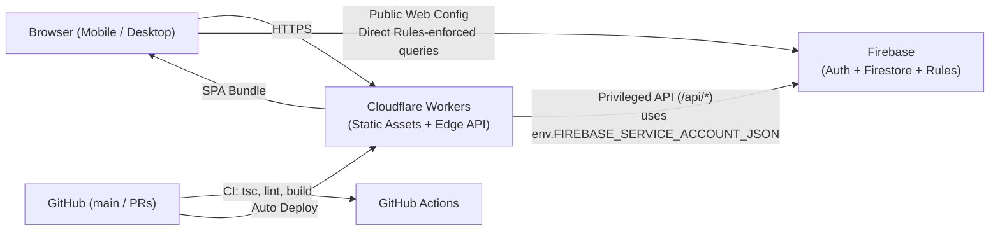

# Calc Web Application

A production-grade, mobile-first web application built with **React + TypeScript + Vite**, **Firebase** (Auth & Cloud Firestore with Security Rules), **Cloudflare Workers with Static Assets**, and **GitHub Actions CI/CD**.

---

## Architecture Overview



---

## Local Setup

### Prerequisites
- Node.js `>= 24` and `npm`
- A [Firebase](https://console.firebase.google.com/) project (with Authentication and Cloud Firestore enabled)
- A [Cloudflare](https://dash.cloudflare.com/) account (for Worker deployment)

### Steps
1. **Clone the repository:**
   ```bash
   git clone <your-repo-url>
   cd calc
   ```
2. **Install dependencies:**
   ```bash
   npm install
   ```
3. **Configure environment variables:**
   ```bash
   cp .env.example .env
   ```
   Fill in your `VITE_FIREBASE_*` web app configuration from **Firebase Console → Project Settings → Your apps**.
   > **Security Note:** Never add `FIREBASE_SERVICE_ACCOUNT_JSON` or any private key to `.env` or any `VITE_*` variable. For local Worker secrets, create `.dev.vars` (gitignored).
4. **Link Firebase CLI (optional for deploying Firestore rules & indexes):**
   ```bash
   npx firebase login
   npx firebase use --add <your-firebase-project-id>
   ```
5. **Run the local development server:**
   ```bash
   npm run dev
   ```

---

## Firestore & Security Rules Workflow

1. **Define collection schemas and types:**
   - Add Zod schemas in `src/features/<feature>/schemas.ts` and TypeScript interfaces in `src/types/firebase.types.ts`.
2. **Update Firestore Security Rules:**
   - Edit `firestore.rules` to grant explicit `read`, `create`, `update`, and `delete` permissions scoped to `request.auth.uid`, keeping the default deny-all rule at the bottom.
3. **Deploy rules and indexes (manual or automated):**
   - **Automated (GitHub Actions):** Any push to `main` changing `firestore.rules`, `firestore.indexes.json`, or `firebase.json` automatically deploys via `.github/workflows/deploy-firestore.yml` when `FIREBASE_SERVICE_ACCOUNT_JSON` is added to **GitHub Repository → Settings → Secrets and variables → Actions**.
   - **Manual:**
     ```bash
     npx firebase deploy --only firestore
     ```

---

## Production Deployment (GitHub + Cloudflare Workers Builds)

1. **Connect Repository in Cloudflare Dashboard:**
   - Go to **Workers & Pages → Create → Workers → Connect to Git** and select your GitHub repository.
   - Set **Build command** to `npm run build`.
   - Set **Deploy command** to `npx wrangler deploy`.
2. **Configure Public Environment Variables (Build & Runtime):**
   - In Cloudflare Workers **Build variables**, add:
     - `VITE_FIREBASE_API_KEY`
     - `VITE_FIREBASE_AUTH_DOMAIN`
     - `VITE_FIREBASE_PROJECT_ID`
     - `VITE_FIREBASE_STORAGE_BUCKET`
     - `VITE_FIREBASE_MESSAGING_SENDER_ID`
     - `VITE_FIREBASE_APP_ID`
3. **Configure Privileged Worker Secrets (Never in `VITE_*`):**
   - Add server-side secrets via Wrangler or Cloudflare Dashboard (**Settings → Variables and Secrets → Secret**):
     ```bash
     npx wrangler secret put FIREBASE_SERVICE_ACCOUNT_JSON
     ```
4. **Configure Firebase Auth Authorized Domains:**
   - In Firebase Console → **Authentication → Settings → Authorized domains**:
     - Add your production Cloudflare Workers / custom domain (e.g., `app.example.com`) alongside `localhost`.
